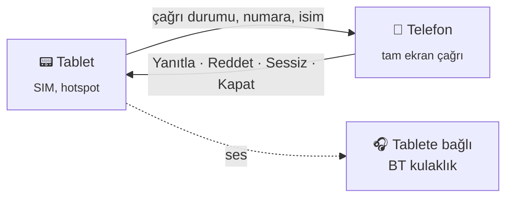

<h1 align="center">📞 CallBridge</h1>

<p align="center">
  SIM'li cihaza (ör. tablet) gelen çağrıyı aynı ağdaki başka bir cihazda gösterip oradan yönetmeyi sağlayan Android uygulaması.
</p>

---

## Neden?

SIM kart çoğu zaman tek bir cihazda durur. O cihaz çantadayken, şarjdayken ya da başka odadayken gelen çağrıyı kaçırmak kolaydır. CallBridge çağrıyı, aynı ağdaki yanınızda duran cihaza taşır: kimin aradığını orada görür, çağrıyı oradan yanıtlar, reddeder ya da susturursunuz.

CallBridge iki cihaza da kurulur. Hangi cihazın hangi rolde çalışacağı eşleştirme sırasında seçilir:



## Kullanım

1. **Tablet:** CallBridge'i aç, **Tablet** rolünü seç ve **Başlat**'a bas. İstenen izinleri ver. Ekranda 6 haneli bir PIN çıkar.
2. **Telefon:** Telefonu tabletin hotspot'una bağla. CallBridge'i aç, **Telefon** rolünü seç, PIN'i gir ve **Başlat**'a bas.
3. **Test çağrısı** düğmesi gerçek bir arama yapmadan akışı dener.

Çağrı gelince telefonda tam ekran çağrı ekranı açılır ve telefon çalar. Telefon bağlıyken tabletin zili susturulabilir. İki cihazda da servis cihaz açılınca kendiliğinden başlar.

## Ses

Telefondan yanıtlanan çağrıda konuşma telefondan yapılır: karşı tarafın sesi telefonun ahizesine (bağlıysa Bluetooth kulaklığa, istenirse hoparlöre) gelir, telefonun mikrofonu çağrıya gider. Aktarım sürerken tabletin mikrofonu kapanır ve çağrı sesi en kısığa iner.

Android normal uygulamalara çağrının sesini vermiyor. Bunu tablette shell yetkisiyle çalışan **ses aktarıcısı** (`RelayDaemon`) yapar:

- Karşı tarafın sesini `VOICE_DOWNLINK` kaynağından alıp UDP `47124` ile telefona gönderir.
- Telefonun mikrofonunu UDP `47125`'ten alıp tabletin "Telephony Tx" ucuna verir.
- Yalnızca tabletin içinden (`127.0.0.1:47126`) ve yalnızca CallBridge'in bağlantısını kabul eder; bağlananın kimliği sistemin bağlantı tablosundan doğrulanır.

Aktarıcı tablet yeniden başlayana kadar çalışır. Her açılıştan sonra tablet USB ile Mac'e bağlıyken bir kez başlatılır:

```bash
./setup.sh relay
```

Aktarıcı kapalıysa çağrı yine telefondan yönetilir, ama ses tablette kalır.

## Mac uygulaması

`desktop/` klasöründe, menü çubuğunda duran bir Mac uygulaması var. Tablete gelen çağrı Mac'te de çalar; sağ üstte küçük bir çağrı penceresi ve bildirim çıkar. Çağrı Mac'ten yanıtlanır, Mac'in mikrofonu ve hoparlörüyle konuşulur. Arama da Mac'ten yapılır: son aramalar (tabletten), rehber (Mac'in Kişiler'i) ve tuş takımı. Mac'te bir telefon numarasına tıklamak da CallBridge ile arar.

Telefon ve Mac aynı anda bağlıyken gelen arama ikisinde birden çalar. Hangisinden yanıtlanırsa ses oraya gelir, diğerinde "Bu cihaza al" çıkar. Tablette yanıtlanan çağrının sesi tablette kalır.

```bash
cd desktop
./build.sh --install --run   # derler, /Applications'a kurar ve açar
```

Mac tabletin hotspot'una bağlı olmalı. PIN menüdeki Ayarlar'dan girilir.

## Hotspot TTL ile birlikte

[Hotspot TTL](../HotspotTTL) telefonda açıkken CallBridge'i VPN'in dışında tutar, böylece tablete giden bağlantı VPN'den geçmez.

## Kurulum

Android SDK ve JDK 17+ gerekir.

```bash
./gradlew assembleDebug
```

İki cihaz da USB ile bağlıysa tek komutla kurulup eşleştirilebilir:

```bash
./setup.sh           # kurar, izinleri verir, PIN'i iki cihaza yazar, bağlantıyı doğrular
./setup.sh --test    # sonra test çağrısını da dener
```

SIM'i olan cihaz otomatik olarak tablet sayılır. Gerekirse seri numaraları elle verilebilir: `./setup.sh <tablet> <telefon>`.

## Nasıl çalışıyor?

- Bağlantı TCP `47123` portunda, satır başına bir JSON mesajıyla kurulur. Kimlik doğrulama PIN'den türetilen HMAC ile yapılır.
- Tablet çağrı durumunu `ACTION_PHONE_STATE_CHANGED` yayınından alır. Numara için arama kaydı izni, isim için rehber izni kullanılır.
- Komutlar `TelecomManager.acceptRingingCall()` / `endCall()` ve `AudioManager` ile uygulanır.
- Telefon tabletin adresini hotspot'un ağ geçidinden bulur; adres elle de girilebilir.

## Proje yapısı

```
app/src/main/java/com/serhanensar/callbridge/
├── Bridge.kt               # protokol, PIN/HMAC, ayarlar
├── CallHostService.kt      # tablet: çağrıyı izler, komutları uygular
├── BridgeClientService.kt  # telefon: bağlantı, yeniden bağlanma
├── CallNotifier.kt         # çağrı bildirimleri
├── CallAudio.kt            # telefon: çağrı sesini çalar, mikrofonu gönderir
├── RelayDaemon.kt          # tablet: shell yetkili ses aktarıcısı
├── Ringer.kt               # telefonun zili
├── IncomingCallActivity.kt # tam ekran çağrı ekranı
├── BridgeActivity.kt       # kurulum ekranı
├── BootReceiver.kt         # açılışta yeniden başlatma
└── Ui.kt                   # renkler ve arayüz yardımcıları
```
