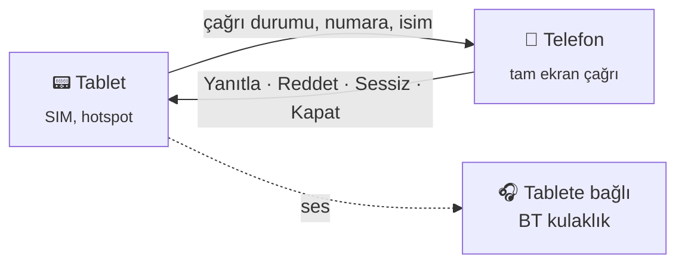

<h1 align="center">📞 CallBridge</h1>

<p align="center">
  SIM'li cihaza (ör. tablet) gelen çağrıyı aynı ağdaki başka bir cihazda gösterip oradan yönetmeyi sağlayan Android uygulaması.
</p>

---

## Neden?

SIM kart çoğu zaman tek bir cihazda durur. O cihaz çantadayken, şarjdayken ya da başka odadayken gelen çağrıyı kaçırmak kolaydır. CallBridge çağrıyı, aynı ağdaki yanınızda duran cihaza taşır: kimin aradığını orada görür, çağrıyı oradan yanıtlar, reddeder ya da susturursunuz.

CallBridge iki cihaza da kurulur. Hangi cihazın hangi rolde çalışacağı eşleştirme sırasında seçilir:



## Kullanım

1. **Tablet:** CallBridge'i aç, **Tablet** rolünü seç ve **Başlat**'a bas. İstenen izinleri ver. Ekranda 6 haneli bir PIN çıkar.
2. **Telefon:** Telefonu tabletin hotspot'una bağla. CallBridge'i aç, **Telefon** rolünü seç, PIN'i gir ve **Başlat**'a bas.
3. **Test çağrısı** düğmesi gerçek bir arama yapmadan akışı dener.

Çağrı gelince telefonda tam ekran çağrı ekranı açılır ve telefon çalar. Telefon bağlıyken tabletin zili susturulabilir. İki cihazda da servis cihaz açılınca kendiliğinden başlar.

## Ses

Android, root olmadan çağrının sesini başka bir uygulamaya vermiyor. Telefon çağrıyı gösterir ve yönetir; konuşma tabletin kendisinden ya da ona bağlı bir Bluetooth kulaklıktan yapılır.

## Hotspot TTL ile birlikte

[Hotspot TTL](../HotspotTTL) telefonda açıkken CallBridge'i VPN'in dışında tutar, böylece tablete giden bağlantı VPN'den geçmez.

## Kurulum

Android SDK ve JDK 17+ gerekir.

```bash
./gradlew assembleDebug
```

İki cihaz da USB ile bağlıysa tek komutla kurulup eşleştirilebilir:

```bash
./setup.sh           # kurar, izinleri verir, PIN'i iki cihaza yazar, bağlantıyı doğrular
./setup.sh --test    # sonra test çağrısını da dener
```

SIM'i olan cihaz otomatik olarak tablet sayılır. Gerekirse seri numaraları elle verilebilir: `./setup.sh <tablet> <telefon>`.

## Nasıl çalışıyor?

- Bağlantı TCP `47123` portunda, satır başına bir JSON mesajıyla kurulur. Kimlik doğrulama PIN'den türetilen HMAC ile yapılır.
- Tablet çağrı durumunu `ACTION_PHONE_STATE_CHANGED` yayınından alır. Numara için arama kaydı izni, isim için rehber izni kullanılır.
- Komutlar `TelecomManager.acceptRingingCall()` / `endCall()` ve `AudioManager` ile uygulanır.
- Telefon tabletin adresini hotspot'un ağ geçidinden bulur; adres elle de girilebilir.

## Proje yapısı

```
app/src/main/java/com/serhanensar/callbridge/
├── Bridge.kt               # protokol, PIN/HMAC, ayarlar
├── CallHostService.kt      # tablet: çağrıyı izler, komutları uygular
├── BridgeClientService.kt  # telefon: bağlantı, yeniden bağlanma
├── CallNotifier.kt         # çağrı bildirimleri
├── IncomingCallActivity.kt # tam ekran çağrı ekranı
├── BridgeActivity.kt       # kurulum ekranı
├── BootReceiver.kt         # açılışta yeniden başlatma
└── Ui.kt                   # renkler ve arayüz yardımcıları
```
